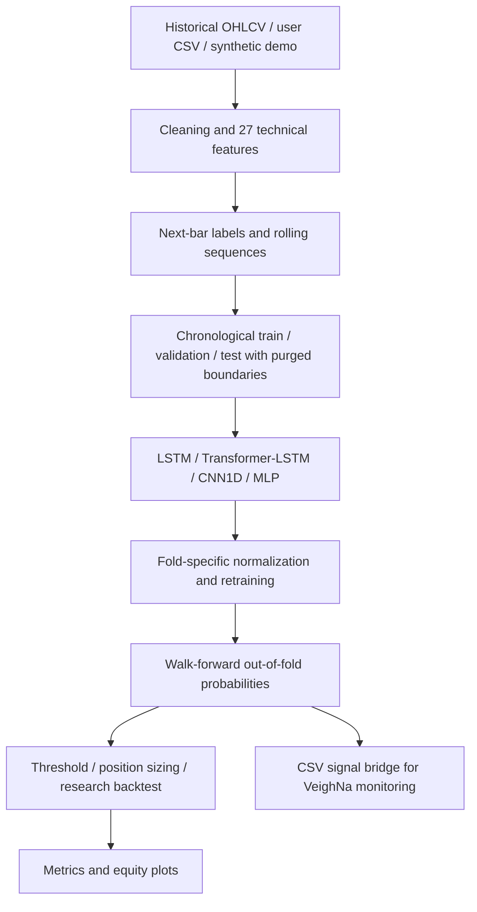

# A-Share Deep Learning Trading Research

**A reproducible research pipeline for sequential price-direction modeling and walk-forward evaluation on Chinese A-share daily bars.**

`Python` · `PyTorch` · `LSTM` · `Transformer–LSTM` · `CNN1D` · `MLP` · `Optuna` · `Time-Series CV` · `Walk-Forward Backtesting`

> **Research prototype · not investment advice · not a live trading system.** The default example uses **daily OHLCV**, not intraday tick, minute-level or high-frequency data. The optional VeighNa component is an **offline CSV signal monitor** that deliberately **does not submit orders**.

[中文说明](README_CN.md) · [Methodology](docs/METHODOLOGY.md) · [Release notes](docs/RELEASE_NOTES.md) · [Publication checklist](PUBLICATION_CHECKLIST.md)

## Overview

This project investigates whether sequential neural networks can predict the sign of the next daily close-to-close return. It separates historical data ingestion, handcrafted technical features, chronological model development, out-of-fold probability generation, and an *idealized* single-asset backtest. The original research components are retained, while the public-release pipeline has safer credentials handling and explicit evaluation boundaries.



### Research scope

| Component | Implementation | Notes |
| --- | --- | --- |
| Asset / source | Example: `688981.SH` via Tushare Daily API | Substitute your own licensed OHLCV CSV |
| Input | Open, high, low, close and volume | 27 derived technical features; 30-bar default lookback |
| Target | `1{close[t+1] > close[t]}` | Last unobservable target is excluded |
| Models | LSTM, Transformer-LSTM, CNN1D, MLP | PyTorch modules under `models/` |
| Development | Purged expanding-window CV, optional Optuna | Per-fold standardization; results are *development* AUC |
| Evaluation | Train/validation/retrain on past data; consecutive unseen test blocks | Per-fold predictions with timestamp and metadata |
| Position logic | Probability thresholds, exposure sizing, illustrative stop | Not exchange-accurate execution |
| Integration | Historical CSV signal export + VeighNa listener | Disabled orders by design |

## Quick start — no API credentials needed

Python **3.10+** recommended. Create a virtual environment, then install core packages:

```bash
python -m venv .venv
# Windows PowerShell: .\.venv\Scripts\Activate.ps1
# macOS/Linux: source .venv/bin/activate
pip install -r requirements.txt
```

Run a small **synthetic smoke test** (it is NOT a performance demonstration):

```bash
python run_stage_a.py --demo --model mlp --mode walk_forward --epochs 2 --test-bars 100
python scripts/plot_results.py
```

Generated CSVs, JSON and chart(s) will appear in the locally created `artifacts/` folder. Git ignores that folder, keeping the repository free from datasets, licensed data, weights, and old metrics.

### Real research data: authorized CSV

Prepare daily records with columns `datetime,open,high,low,close,volume`, or Tushare's `trade_date,open,high,low,close,vol` convention. Run:

```bash
python run_stage_a.py --data-csv path/to/your_daily_ohlcv.csv --model lstm --mode walk_forward --epochs 30
```

Dates are chronologically sorted and basic missing fields removed. Do not mix instruments/frequencies in one CSV. Ensure your data provider permits the proposed use and distribution.

### Real research data: Tushare

The API connector is optional. Install it and set a **private** environment variable:

```powershell
# Windows PowerShell
pip install tushare
$env:TUSHARE_TOKEN="YOUR_PRIVATE_TOKEN"
python run_stage_a.py --source tushare --ticker 688981.SH --start 20220101 --end 20251231 --model lstm
```

```bash
# macOS/Linux
pip install tushare
export TUSHARE_TOKEN="YOUR_PRIVATE_TOKEN"
python run_stage_a.py --source tushare --ticker 688981.SH --start 20220101 --end 20251231 --model lstm
```

**Never paste your actual token into a code file, Git commit, README or issue.** A previous internal project copy used an embedded token: that credential must be revoked/rotated before publishing any repository built from that older copy.

## Running experiments

```bash
# Primary evaluation: fixed-configuration chronological walk-forward
python run_stage_a.py --data-csv YOUR.csv --mode walk_forward --model lstm --epochs 30

# Development-only: purged CV with optional Optuna and feature explainability
python run_stage_a.py --data-csv YOUR.csv --mode full --model hybrid --optuna-trials 10 --explain

# Optional SHAP (install `shap` separately); --shap requires --explain
python run_stage_a.py --data-csv YOUR.csv --mode full --model lstm --explain --shap

# Ensemble: average four separately created walk-forward prediction streams
python run_stage_a.py --data-csv YOUR.csv --mode ensemble --epochs 30

# Visualize generated walk-forward net-asset values
python scripts/plot_results.py

# Run tests (install pytest if missing)
python -m pytest -q
```

`--mode full` does **not** produce a strategy return; it saves development AUC and artifacts. Its selected best-fold model is not independently tested; use walk-forward instead for exploratory out-of-fold curves. `--mode ensemble` uses an **equal-weight mean of OOS probabilities**, deliberately not ex-post performance-derived weights. The older weighted-ensemble implementation is retained in `models/ensemble.py` for research reference only; it is **not called by this pipeline**.

For reproducibility, sample metadata, fold predictions, fold boundaries and metrics are written per run. Use different `--output` paths if you want to compare versions without overwriting artifacts.

## Results & interpretation

This public repository **does not reproduce or advertise any historical Sharpe/return numbers from the internal archive**: the previous results were produced with different sequence alignment and validation rules. They must be recalculated on authorized real market data with this version before they can be reported as comparable evidence.

Out-of-fold model probabilities do **not** make a backtest executable. The current close-to-close approximation fills decisions at the observed close, charges simple two-sided trading costs upon turnover, and does not faithfully simulate STAR Market / A-share restrictions, T+1 settlement/sell restrictions, suspension, price limits, limit-book liquidity, auction mechanics or taxes. These restrictions can materially change returns. For details see [Methodology](docs/METHODOLOGY.md).

## Repository map

```text
.
├── data/                  # Tushare optional adapter; CSV parser; synthetic smoke generator
├── features/              # 27 indicator features, target, sequence builder, normalization
├── models/                # LSTM, Transformer-LSTM, CNN1D, MLP, historical ensemble helper
├── training/              # Torch training, time-series CV, Optuna
├── backtesting/           # Idealized exposure/cost backtest; walk-forward forecast generator
├── explainability/        # Gradient, permutation, SHAP (optional), ranking stability
├── strategy/              # Optional VeighNa CSV listener — no order submission
├── scripts/plot_results.py
├── notebooks/01_data_check.ipynb
├── config/default.json       # Example configuration metadata
├── tests/                  # No-leakage unit tests + offline integration smoke test
├── docs/                   # Methodology and release notes
├── requirements.txt
├── requirements-optional.txt
└── run_stage_a.py           # Argument-driven research entry point
```

## Status, limitations and attribution

- This release is intended for **personal research and code-review demonstration**, not as an investment product.
- A public GitHub repository **does not imply a license to use third-party market data, employer IP or non-public research**. Confirm publication rights before switching visibility to Public.
- This repository intentionally ships without a software reuse LICENSE while ownership/authorization is being verified; copying and reuse rights should not be assumed.
- The original codebase dates to an internship-stage research prototype; the GitHub release contains public-safety and chronology changes documented in [release notes](docs/RELEASE_NOTES.md).
- Empirical conclusions and any prior experimental result would need revalidation after these changes.
